<div align="center">



[](LICENSE)
[](ai_vision)
[](frontend)
[](https://jayaprakash-pixel.github.io/Real-time-Visual-Identification-System/)

**A phone is the CCTV. The laptop is the control room.**
Register a missing person once. The AI watches the live feed and confirms them over several frames.

[**Live site (3D + motion)**](https://jayaprakash-pixel.github.io/Real-time-Visual-Identification-System/) ·
[Architecture](#architecture) · [Status](#project-status) · [Quick start](#quick-start)

</div>

---

## How it works



1. The operator registers a missing person with a photo (**Module 1**).
2. A phone or CCTV camera streams live video to the laptop.
3. The AI keeps only the newest frame, finds faces, tracks them, and compares each face with the registered people (**Module 2**).
4. A match counts only when the same tracked face matches in **3 of the last 5 checks** with an average score of **0.40 or more**.
5. The system saves the full scene, the face crop, and a log line. It then raises an alert (**Module 3**).

## Architecture


| Folder | What it holds |
|---|---|
| [`ai_vision/`](ai_vision) | Module 2. Live pipeline in Python and OpenCV (user stories US-01 to US-12). |
| [`frontend/`](frontend) | Module 1. React operator console: login, registration, missing persons, detection history. |
| [`server/`](server) | Module 3 plus the glue. Alert gate, detection store, alert dispatcher, REST API, live MJPEG stream, WebSocket alerts, Supabase person sync. Runs the AI in-process and serves the built frontend. |
| [`alerts/`](alerts) | The original Module 3 console demo (kept for reference; superseded by `server/`). |
| [`e2e/`](e2e) | Browser end-to-end and fault-injection runs. |
| [`phasedoc/`](phasedoc) | Build tracker: plan, acceptance tests, and the results of every run. |
| [`site/`](site) | Project landing page. Three.js 3D hero and Framer Motion animation. Deployed to GitHub Pages. |
| [`docs/specs/`](docs/specs) | Project description and user stories. |

## Project status

This table is deliberately honest.

| Area | Status | Notes |
|---|---|---|
| Frame buffer, detection, alignment, embedding | ✅ Built | YuNet and SFace ONNX models, CPU only. |
| Tracking, quality gate, selective recognition | ✅ Built | |
| Matching, 3-of-5 verification, evidence capture | ✅ Built | Cosine threshold 0.363. |
| Detection history search | ✅ Built | CLI in `ai_vision/us-12`. |
| Alert engine: gate, store, dispatcher, optional Telegram | ✅ Built | 13 unit tests. 55% minimum confidence and 30 s per-person cooldown by default. |
| Server: auth, detections API, live MJPEG, WebSocket alerts | ✅ Built | Auth on every route. Login throttle. See [`docs/security.md`](docs/security.md). |
| AI → alerts → dashboard, end to end | ✅ Verified on video files | Registered person: 1 popup, 1 history row, 1 evidence image. Unregistered person: nothing. See [`phasedoc/E2E-RESULTS.md`](phasedoc/E2E-RESULTS.md). |
| Fault recovery (camera drop, server restart, Supabase down) | ✅ Verified | Dashboard recovers without a reload. |
| Frontend wired to the real server | ✅ Built | Set `VITE_USE_MOCK=false`. Popup, alarm sound, history, live feed. |
| Supabase person sync | 🟡 Partial | Tested against a fake Supabase. **Not yet run against the real project** (keys pending). |
| Phone camera over Wi-Fi | 🟡 Partial | A fake MJPEG phone camera was tested. A real phone was not. |
| Server under PM2 (Windows) | ✅ Built | Survives a service restart. |

## Quick start

**You need:** Python 3.11+, Node.js 18+, a camera (webcam, or a phone running the "IP Webcam" app), and a Supabase project with a `missing_persons` table and a `person-photos` bucket (see [`docs/supabase.md`](docs/supabase.md)). Tested on Windows 11. The face models are included in the repo (`ai_vision/us-02/models`), so no download is needed.

**Whole product (one port)** (PowerShell; on Linux/macOS use `source .venv/bin/activate` and `/` paths)

```powershell
python -m venv .venv
.venv\Scripts\activate
pip install -r requirements.txt       # server + AI module
cp .env.example .env                  # then edit: camera source, Supabase URL + publishable key
cp frontend\.env.example frontend\.env   # then edit: the same Supabase URL + key
cd frontend; npm install; npm run build; cd ..
python server/run.py                  # http://127.0.0.1:8010
```

Open the address, create the first account (it becomes the admin), register a person, and watch the dashboard. Camera: `RTVIS_CAMERA_SOURCE=0` for a webcam, or `http://<phone-ip>:8080/video` for the IP Webcam phone app.

**Tests**

```bash
python -m pytest                       # 46 tests; 3 face-based ones are skipped unless RTVIS_TEST_FACES points to test photos
```

**AI module alone** (no server)

```bash
cd ai_vision
python us-05/reference_store.py capture MP001 "Your Name"   # register 5 poses
python main.py                                              # laptop webcam
```

**Frontend dev server** (hot reload; mock data unless `VITE_USE_MOCK=false` and the server is running)

```bash
cd frontend && npm install && npm run dev
```

**Landing site**

```bash
cd site && npm install && npm run dev
```

## Privacy

Face photos and embeddings are biometric data. `data/`, `*.npz` and `.env` are git-ignored. Never commit them.

## License

Licensed under the [Apache License 2.0](LICENSE).
