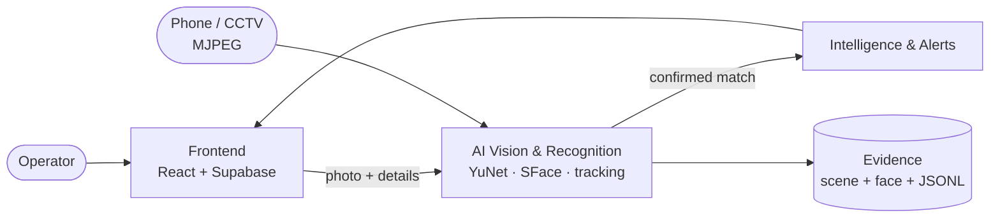

<div align="center">


[](LICENSE)
[](ai_vision)
[](frontend)
[](https://jayaprakash-pixel.github.io/Real-time-Visual-Identification-System/)

**A phone is the CCTV. The laptop is the control room.**
Register a missing person once. The AI watches the live feed and confirms them over several frames.

[**Live site (3D + motion)**](https://jayaprakash-pixel.github.io/Real-time-Visual-Identification-System/) ·
[Architecture](#architecture) · [Status](#project-status) · [Quick start](#quick-start)

</div>

---

## How it works


1. The operator registers a missing person with a photo (**Module 1**).
2. A phone or CCTV camera streams live video to the laptop.
3. The AI keeps only the newest frame, finds faces, tracks them, and compares each face with the registered people (**Module 2**).
4. A match counts only when the same tracked face matches in **3 of the last 5 checks** with an average score of **0.40 or more**.
5. The system saves the full scene, the face crop, and a log line. It then raises an alert (**Module 3**).

## Architecture



| Folder | What it holds |
|---|---|
| [`ai_vision/`](ai_vision) | Module 2. Live pipeline in Python and OpenCV (user stories US-01 to US-12). |
| [`frontend/`](frontend) | Module 1. React operator console: login, registration, missing persons, detection history. |
| [`alerts/`](alerts) | Module 3. Match verification and alert service. Early stage. |
| [`site/`](site) | Project landing page. Three.js 3D hero and Framer Motion animation. Deployed to GitHub Pages. |
| [`docs/specs/`](docs/specs) | Project description and user stories. |

## Project status

This table is deliberately honest.

| Area | Status | Notes |
|---|---|---|
| Frame buffer, detection, alignment, embedding | ✅ Built | YuNet and SFace ONNX models, CPU only. |
| Tracking, quality gate, selective recognition | ✅ Built | |
| Matching, 3-of-5 verification, evidence capture | ✅ Built | Cosine threshold 0.363. |
| Detection history search | ✅ Built | CLI in `ai_vision/us-12`. |
| Frontend (login, register, persons, history) | 🟡 Partial | Persons use Supabase. Detections and live stream use mock mode until a backend exists. |
| Alerts and match verification service | 🟠 Early | A console and beep demo only. |
| Link between frontend, AI and alerts | 🔜 Roadmap | Next milestone. |

## Quick start

**AI module**

```bash
cd ai_vision
python -m venv venv && venv\Scripts\activate
pip install -r requirements.txt
python us-05/reference_store.py capture MP001 "Your Name"   # register 5 poses
python main.py                                              # laptop webcam
python main.py --source http://<phone-ip>:8080/video --camera-id PHONE1
```

**Frontend**

```bash
cd frontend
cp .env.example .env     # add your Supabase URL and publishable key
npm install && npm run dev
```

**Landing site**

```bash
cd site && npm install && npm run dev
```

## Privacy

Face photos and embeddings are biometric data. `data/`, `*.npz` and `.env` are git-ignored. Never commit them.

## License

Licensed under the [Apache License 2.0](LICENSE).
